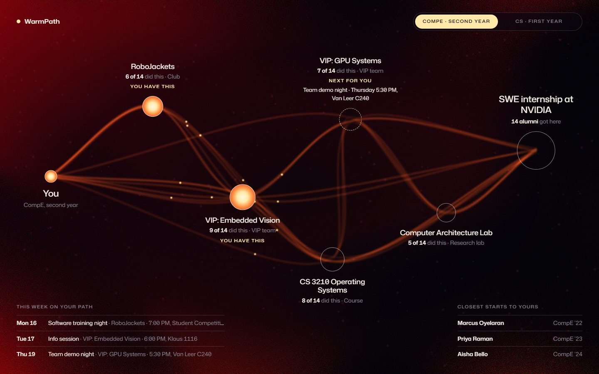
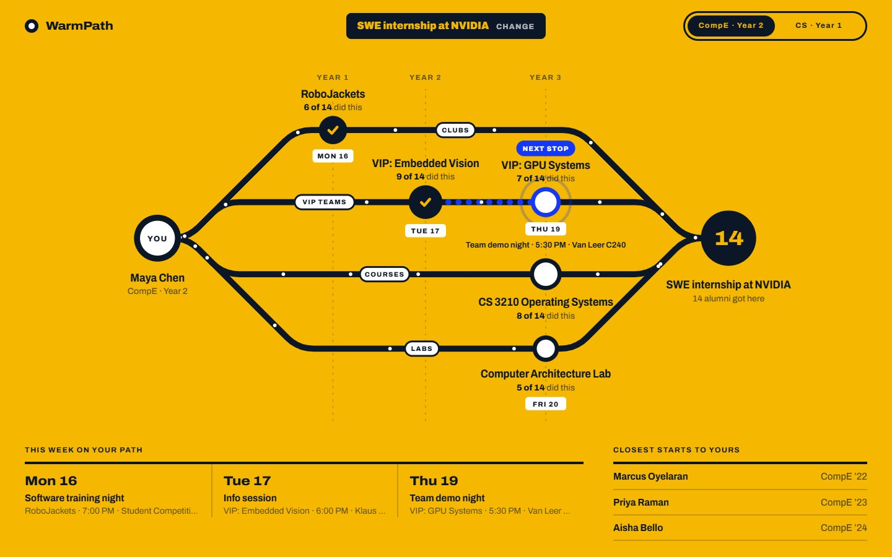
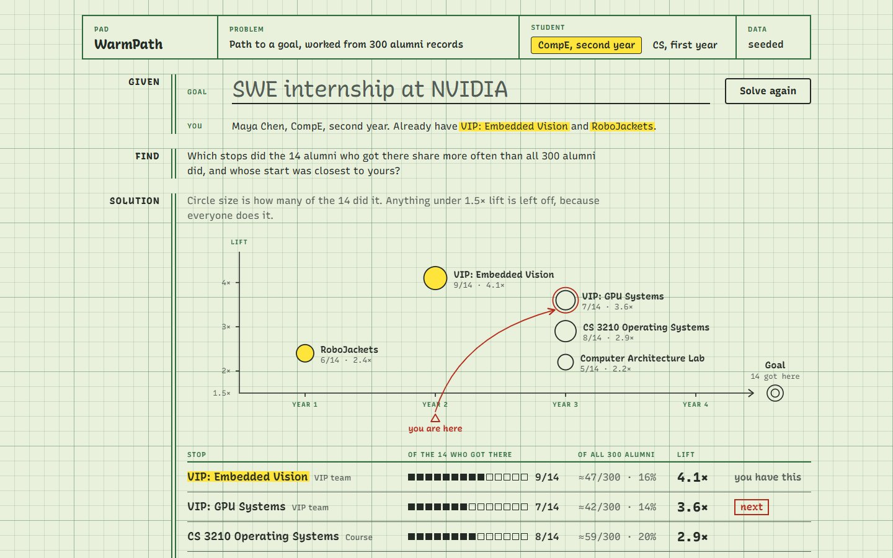

# Design direction prototypes

Three throwaway prototypes of the four WarmPath screens (goal box, path map, people panel, alum reply page). They exist so the team can pick a look and a motion budget. None of this is production code, and nothing here is wired to the backend.

| Direction | Look | Motion | Built with |
| --- | --- | --- | --- |
| [Thermal](thermal/index.html) | Near-black, heat-coloured strands, one strand per alum who reached the goal | High: WebGL particles, routes that draw themselves | React, react-three-fiber, ShaderGradient, loaded from a CDN |
| [Transit](transit/index.html) | Yellow ground, black transit lines, one line per activity type | Medium: lines draw on, riders move, the next-stop flag slides | Plain SVG and the Web Animations API |
| [Engineering pad](pad/index.html) | Green grid paper, a worked Given / Find / Solution problem | Low: press feedback and 200ms reveals | HTML and CSS, a little script |





## Running them

Open [index.html](index.html) in a browser, or serve the folder:

```
cd prototypes
python -m http.server 4712
```

Then visit `http://localhost:4712`. Thermal needs an internet connection for its libraries. The prototypes are laid out for a laptop screen; the alum reply page (`#/reply/5` on any of them) is the one screen sized for a phone.

To try the two-device beat, send an ask from the people panel, follow its "open the reply page" link into a second tab, and accept there. The first tab updates on its own.

## Data

[shared/fake-api.js](shared/fake-api.js) holds invented data and one function per endpoint in [docs/mvp.md](../docs/mvp.md#api-contract), returning the same JSON shapes. Every person is made up and the events are placeholders.

One field is not in the contract: each stop carries `typical_year`. All three maps need some way to place a stop left to right, and lift alone does not give one. If the team wants any of these layouts, the path engine would need to return something like it (the median `school_year` from PersonActivity would do), and the contract in `docs/mvp.md` would change with it.

Whatever goal is typed, the prototypes draw the one seeded path, the NVIDIA internship.
